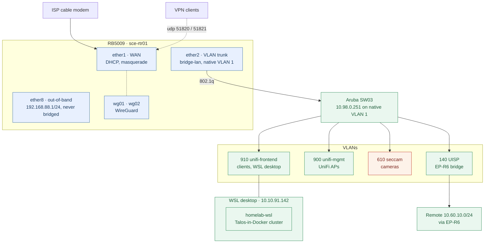
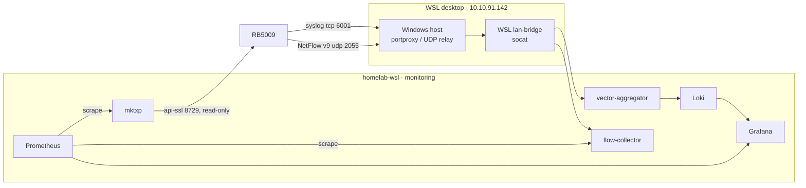

# Network architecture

One MikroTik RB5009 (`sce-rtr01`) is the router, firewall, DNS, DHCP, NTP and
VPN endpoint. Its configuration is Terraform
(`infrastructure/terraform/modules/mikrotik`, values in the generated
`environments/prod/mikrotik/locals.tf`). The EdgeRouter Lite and VyOS are
retired and kept powered off as a rollback until Phase 5 of
[`../mikrotik-cutover-checklist.md`](../mikrotik-cutover-checklist.md).

Diagrams are Mermaid in this file: GitHub renders them inline, and a change
shows up as a readable diff. Edit them here; there is no build step.

## Topology

## VLANs and zones

Each VLAN is a zone (an interface list) in the router's zone firewall. A
zone pair with no rule falls to the terminal forward drop.

| VLAN | Zone | Subnet (router) | Purpose |
| --- | --- | --- | --- |
| 1 (native) | `switch-mgmt` | `10.98.0.1/24` | Switch management, untagged on ether2 |
| 10 | `transit-10` | `172.16.1.250/24` | Old upstream hop; `ether1` is in this zone as the outside |
| 140 | `UISP-140` | `10.10.140.1/24` | EP-R6 bridge; `10.60.10.0/24` is routed via `10.10.140.140` |
| 610 | `seccam-610` | `10.10.60.1/24` | Cameras. Untrusted: router services only, Frigate pulls RTSP |
| 900 | `unifi-mgmt-900` | `10.10.90.1/24` | UniFi AP management |
| 910 | `unifi-frontend-910` | `10.10.91.1/24` | Main client network; hosts the WSL desktop |
| — | `vpn` (wg01) | `10.10.30.1/24` | Admin VPN |
| — | `vpn-mobile` (wg02) | `10.10.31.1/24` | Mobile VPN: internet and 910, plus admin peers by address |

`ether8` (`192.168.88.1/24`) is outside every zone and always accepts
management, for break-glass.

## Access

Management of the router, switch, APs and radios is reachable only over the
admin VPN or from an admin peer; nothing on the WAN answers except WireGuard.
The full model and the break-glass steps are in
[`../network-access.md`](../network-access.md).

## Services on the router

| Service | How |
| --- | --- |
| DNS | RouterOS resolver for every VLAN, upstream Cloudflare over DoH, adlists for blocking, static records for local names. DNS from 910 and 610 is redirected to the router |
| DHCP | One server per VLAN, static leases for known devices |
| NTP | Router serves the LAN; NTP from 900, 910, 610 and 140 is redirected to it. Not reachable from the WAN |
| WireGuard | `wg01` (udp 51820, admin) and `wg02` (udp 51821, mobile) |
| Dynamic DNS | A scheduled script updates the Cloudflare record the WireGuard clients use as their endpoint (hostname in SOPS) |

LAN clients reach services on the WSL cluster through the desktop:
`*.internal.tnwks.us` resolves to `10.10.91.142`, which forwards into the
cluster. See [`../wsl-lan-exposure.md`](../wsl-lan-exposure.md).

## Observability

- **Metrics:** mktxp polls the router's read-only API over api-ssl, which
  only the desktop's address may reach (address list `monitoring`).
- **Logs:** the router ships syslog over TCP to the desktop, which relays it
  to `vector-aggregator`; Vector writes to Loki.
- **Flows:** NetFlow v9 from the WAN interface goes to `flow-collector`, for
  per-client upload and download.

## Not running

UISP and the UniFi controller ran as containers on VyOS and have no host yet.
The APs and radios keep working without them; adoption and firmware changes
wait until the controllers are hosted again.
