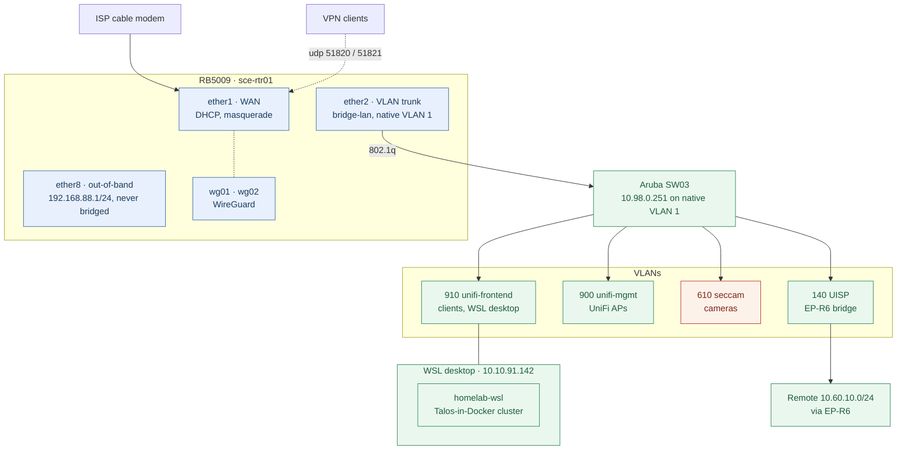
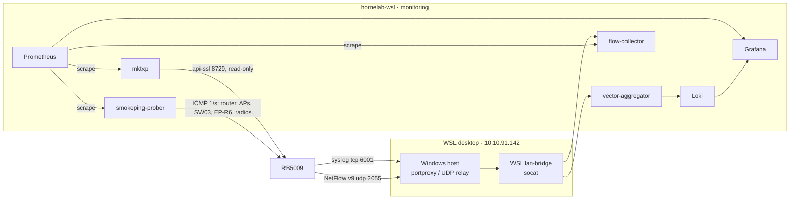

# Network architecture

One MikroTik RB5009 (`sce-rtr01`) is the router, firewall, DNS, DHCP, NTP and
VPN endpoint. Its configuration is Terraform
(`infrastructure/terraform/modules/mikrotik`, values in the generated
`environments/prod/mikrotik/locals.tf`). The EdgeRouter Lite and VyOS are
retired and kept powered off as a rollback until Phase 5 of
[`migration/cutover-checklist.md`](migration/cutover-checklist.md).

Diagrams are Mermaid in this file: GitHub renders them inline, and a change
shows up as a readable diff. Edit them here; there is no build step.

## Topology

## VLANs and zones

Each VLAN is a zone (an interface list) in the router's zone firewall. A
zone pair with no rule falls to the terminal forward drop.

| VLAN | Zone | Subnet (router) | Purpose |
| --- | --- | --- | --- |
| 1 (native) | `switch-mgmt` | `10.98.0.1/24` | Switch management, untagged on ether2. From 910 only the desktop to SW03: SNMP (udp/161) for snmp-exporter and ICMP for smokeping |
| — | `transit-10` | — | The outside (internet) zone: only `ether1`. Its old VLAN 10 transit hop is disabled, so `172.16.1.0/24` is not routed |
| 140 | `UISP-140` | `10.10.140.1/24` | EP-R6 bridge; `10.60.10.0/24` is routed via `10.10.140.140`. From 910 only the desktop: ICMP to the EP-R6 (smokeping) and to the LiteAP radio `.45`, the LiteBeam radio `.43` and the airCube `.46` in `10.60.10.0/24`, and SNMP (udp/161) to the two radios; their SSH and UIs are VPN-only |
| 610 | `seccam-610` | `10.10.60.1/24` | Cameras. Untrusted: router services only, Frigate pulls RTSP |
| 900 | `unifi-mgmt-900` | `10.10.90.1/24` | UniFi AP management. From 910: the controller (inform, SSH, STUN) and ICMP from the desktop to the 3 APs (smokeping) |
| 910 | `unifi-frontend-910` | `10.10.91.1/24` | Main client network; hosts the WSL desktop |
| — | `vpn` (wg01) | `10.10.30.1/24` | Admin VPN |
| — | `vpn-mobile` (wg02) | `10.10.31.1/24` | Mobile VPN: internet and 910, plus admin peers by address |

`ether8` (`192.168.88.1/24`) is outside every zone and always accepts
management, for break-glass.

## Access

Management of the router, switch, APs and radios is reachable only over the
admin VPN or from an admin peer; nothing on the WAN answers except WireGuard.
The full model and the break-glass steps are in
[`access.md`](access.md).

## Services on the router

| Service | How |
| --- | --- |
| DNS | RouterOS resolver for every VLAN, upstream Cloudflare over DoH, adlists for blocking, static records for local names. DNS from 910 and 610 is redirected to the router |
| DHCP | One server per VLAN, static leases for known devices |
| NTP | Router serves the LAN; NTP from 900, 910, 610 and 140 is redirected to it. Not reachable from the WAN |
| WireGuard | `wg01` (udp 51820, admin) and `wg02` (udp 51821, mobile) |
| Dynamic DNS | A scheduled script updates the Cloudflare record the WireGuard clients use as their endpoint (hostname in SOPS) |

LAN clients reach services on the WSL cluster through the desktop:
`*.internal.tnwks.us` resolves to `10.10.91.142`, which forwards into the
cluster. See [`../wsl/lan-exposure.md`](../wsl/lan-exposure.md).

## Observability

- **Metrics:** mktxp polls the router's read-only API over api-ssl, which
  only the desktop's address may reach (address list `monitoring`).
- **Logs:** the router ships syslog over TCP to the desktop, which relays it
  to `vector-aggregator`; Vector writes to Loki.
- **Flows:** NetFlow v9 from the WAN interface goes to `flow-collector`, for
  per-client upload and download.
- **Reachability:** `smokeping-prober` pings the router, the Internet
  targets, the 3 APs, SW03, the EP-R6 and the two radios behind it once a
  second, from the desktop's address. The router allows ICMP from the
  `monitoring` list to the management addresses (`MONITORING_ZONE_RULES` in
  the generator; the EP-R6 in pair `200-unifi-frontend-910-UISP-140`). The
  same pair also allows ICMP from that list to the three devices behind the
  EP-R6: the LiteAP radio `10.60.10.45`, the LiteBeam radio `10.60.10.43`
  and the airCube `10.60.10.46`. It allows SNMP (udp/161) from that list
  to the two radios only, for snmp-exporter; SNMP is still off in the
  radios, so nothing reads their signal yet. Nothing else in
  `10.60.10.0/24` is open from 910.
  The radio link has one alert per hop, each quiet while the hop in front
  of it or the probe's own path (router and SW03) loses pings, so a fault
  pages once: `RadioGatewayUnreachable` (the EP-R6, 4 minutes over half
  lost), `RadioAPUnreachable` (the LiteAP, 4 minutes) and
  `RadioStationUnreachable` (the LiteBeam: the link is down or the station
  is off; 10 minutes, as the far end can be switched off by hand). The
  board is Network & Routing, tab Radio link: a state per hop, loss and
  latency per hop, the router's VLAN 140 counters and the EP-R6's Internet
  traffic from flow export.

## Not running

UISP ran as a container on VyOS and has no host yet. The radios keep working
without it; adoption and firmware changes wait until it is hosted again.
Until then nothing reads the radios themselves: the EP-R6 and the two radios
are watched only by pings and the router's counters (Reachability, above),
and nothing reads their signal or health.

The airCube `10.60.10.46` is not watched: it rejects pings on its WAN side
(ICMP port unreachable), so a probe would read it as always lost. The
router's ICMP rule for it stays, so a probe can be added once the device
answers pings or another source of data exists.

The UniFi controller moved to the WSL cluster (`networking/unifi`), with its
configuration in Terraform; see [`unifi.md`](unifi.md).
