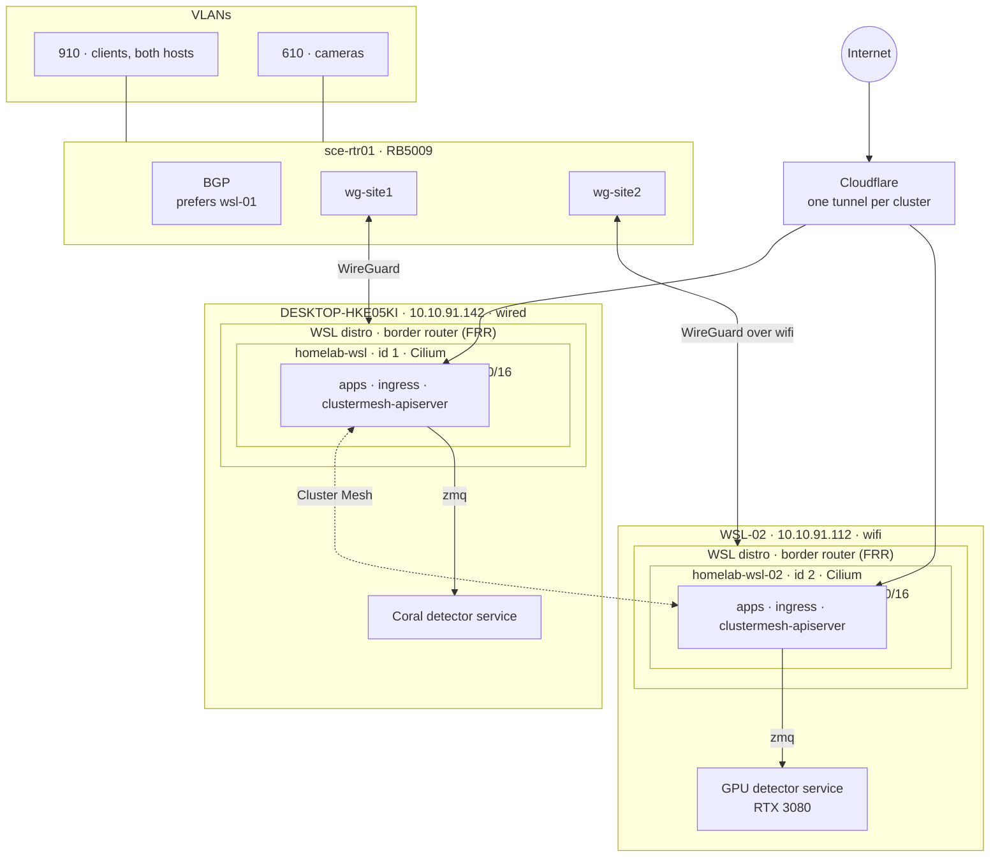
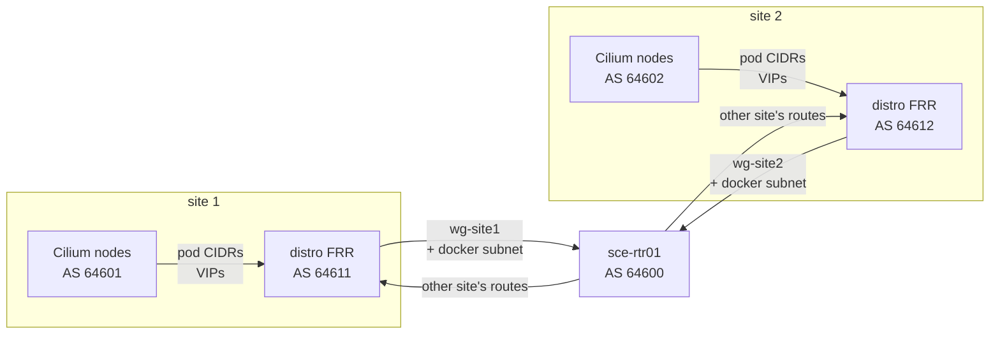
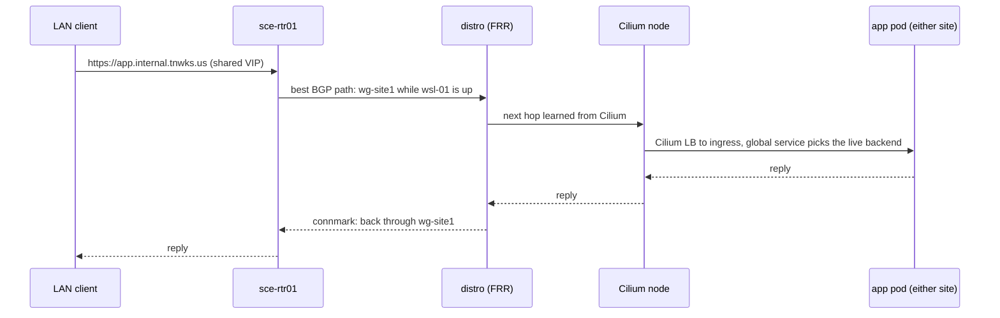
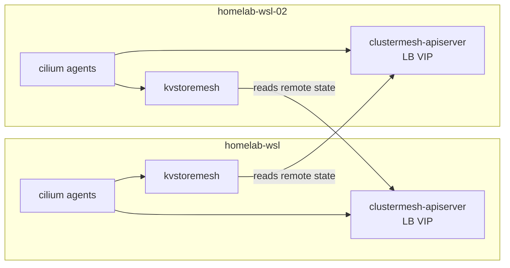
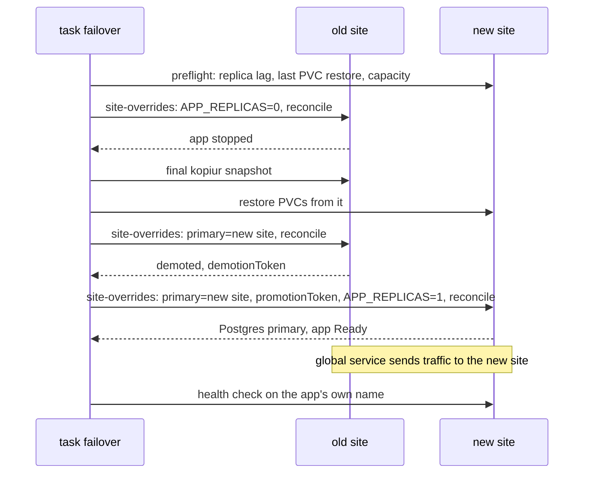
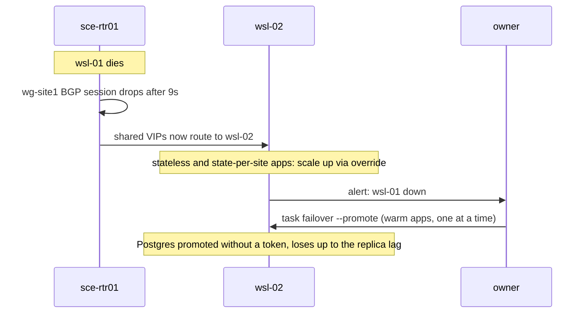

# Multi-site WSL: two clusters, one mesh

**Status: design (2026-11-05).** Nothing here is built. It describes the
target for the two WSL clusters and how an app moves between them, for
[Windows patching](../operations/windows-patching.md) and for real
failures. The [spike plan](#spike-plan) comes before any of it is built.

| | wsl-01 | wsl-02 |
| --- | --- | --- |
| Windows host | `DESKTOP-HKE05KI`, `10.10.91.142`, wired | `WSL-02`, `10.10.91.112`, on wifi |
| Cluster | `homelab-wsl` | `homelab-wsl-02` |
| Role | primary for the home apps; standby for wsl-02's | primary for the non-critical apps; standby for wsl-01's key apps |
| Detector | Coral (Windows service, `zmq`) | RTX 3080 (Windows service, `zmq`) |

## Goals

- Both clusters run Cilium, joined by Cilium Cluster Mesh.
- Any movable app can run on either site. Moving it is a runtime switch
  that takes seconds to minutes: no pull request, no DNS change, and
  nothing on GitHub or CI has to be working.
- LAN and public clients use the same names and addresses whichever site
  is serving.
- Git still describes everything, including each app's default site.
  Flux is still the only thing that applies manifests.
- A planned move loses no data. An unplanned one loses at most the
  replication lag, and promoting a database stays a human decision.

## Superseded: placement map by pull request

The first design (second-cluster plan, 2026-11-04) moved an app by
changing a placement map in a PR, with DNS records generated from it by
Terraform in CI. It is replaced because it puts GitHub, Actions, a runner
on the surviving site, Flux's sync interval and a Terraform apply in the
path of every failover, which is exactly when some of them are likely to
be broken. A failover PR also has to be merged by CI, which needs a bot
token that can bypass review. The default site for each app still lives in
git (below); only the switch moved out of it.

## Topology



Each WSL distro becomes its site's border router. It holds a WireGuard
tunnel to the router, runs FRR, peers BGP with its own Cilium nodes on the
Docker bridge, and passes their routes on to the router. The router never
needs to know which Docker container is which node.

## Addressing

Cluster Mesh needs a unique cluster name and ID per cluster, and pod
ranges that don't overlap. wsl-02 gets its ranges before its bootstrap;
changing them later means rebuilding the cluster.

| | `homelab-wsl` (exists) | `homelab-wsl-02` (decided 2026-11-05) |
| --- | --- | --- |
| Cluster ID | 1 | 2 |
| Docker bridge (nodes) | `10.5.0.0/24` | `10.6.0.0/24` |
| Pods | `10.42.0.0/16` | `10.44.0.0/16` |
| Services | `10.43.0.0/16` | `10.45.0.0/16` |
| BGP ASN (Cilium nodes) | 64601 | 64602 |
| BGP ASN (distro FRR) | 64611 | 64612 |
| WireGuard to the router | `wg-site1` | `wg-site2` |

The router is ASN 64600. Shared service addresses (the ingress VIP, MQTT)
come from one new pool, `10.10.95.0/24`, which both clusters' Cilium LB
IPAM hand out with the same address per service. None of these ranges is
in use in `infrastructure/terraform/modules/mikrotik` or the Talos configs
today; the spike confirms against the live router.

## Network

### Why a routed network

Cluster Mesh needs every node to reach the other cluster's nodes and pods
without address translation. Today nothing outside a host can reach its
nodes: they sit behind Docker's NAT, then WSL's NAT, then Windows. The LAN
bridge (portproxy, socat, UDP relays) only forwards chosen ports.

### WireGuard: one interface per site

- Each distro dials a WireGuard tunnel to the router. The distro starts the
  connection, so WSL's NAT and its changing address don't matter
  (persistent keepalive keeps it open).
- **One WireGuard interface per site on the router, one peer each.**
  WireGuard picks the peer by the packet's destination address, and both
  sites announce the same shared VIP, so two peers on one interface would
  fight over it. With one peer per interface, BGP picks the interface and
  the peer follows. `wg01` stays the admin VPN.
- Each `wg-site` interface is its own zone in the router's zone firewall,
  allowed to reach what the clusters need (cameras, MQTT clients, the
  other site) and nothing else.
- MTU 1420 on the tunnels. Cilium's MTU is set explicitly to match,
  because it only sees the Docker bridge's 1500 and doesn't know about the
  tunnel. The spike measures the real path MTU over wsl-02's wifi.

### BGP



- Cilium's BGP control plane on every node peers with its distro's FRR at
  the Docker bridge gateway (`10.5.0.1`, `10.6.0.1`), which is directly
  connected, so BGP doesn't depend on the tunnel.
- Cilium announces each node's pod CIDR and the LoadBalancer addresses it
  serves. FRR adds the Docker subnet and passes everything to the router,
  with itself as next hop.
- **The router prefers wsl-01** for the shared VIPs (a routing filter on
  the `wg-site2` session sets a lower local preference). wsl-02's
  announcement takes over when wsl-01's session drops.
- Hold timer 9 seconds (keepalive 3), so a dead site is withdrawn in under
  10 seconds. Graceful restart on, so a Cilium agent restart doesn't flap
  the routes.
- All of the router side (interfaces, peers, zones, BGP connections,
  filters) is Terraform in `modules/mikrotik`, like the rest of the router.
  The distro side (WireGuard, FRR, the rules below) is Ansible, roles
  `wsl_*`.

### The distro as a router

- IP forwarding on. Static routes aren't needed: FRR learns its own
  cluster's routes from the nodes and the other site's from the router.
- **Docker 28 drops routed traffic into a bridge network** unless the
  network's gateway mode is `routed` or `nat-unprotected`. The Talos
  network needs one of them, plus a masquerade exemption so traffic from
  the nodes to the other site leaves with its real address. Whether
  `talosctl cluster create docker` can set the option, or Ansible adds the
  rules after it, is a spike item.
- Cilium native routing, with `ipv4NativeRoutingCIDR` covering both pod
  ranges, so pod-to-pod traffic across sites isn't masqueraded. VXLAN would
  only need node routes, but it stacks a tunnel inside WireGuard; BGP is
  needed for the VIPs anyway.
- **Camera ingest stays off WireGuard.** Frigate pulls RTSP the way it does
  today: out through Docker, WSL and Windows' NAT. Only traffic that
  arrives through the tunnel goes back through it: the distro marks
  connections that came in on `wg-site` (connmark) and routes their replies
  back through it with a policy rule. Everything else keeps the default
  route.

### Packet paths



Pod to pod across sites: pod `10.42.x` to its node, the Docker bridge, the
distro, `wg-site1`, the router, `wg-site2`, wsl-02's distro, its node, pod
`10.44.x`. No NAT anywhere on the way.

### Router capacity

Measured on 2026-11-05 at about 00:25:

- RB5009UG+S+, RouterOS 7.25, 4 ARM64 cores. 9 to 11 percent total CPU,
  with the clock scaled down to 350 to 700 MHz at the time.
- Camera VLAN 610 to VLAN 910: about 54 Mbps live, and 55 Mbps averaged
  over 10.3 days of uptime (6.13 TB received on `bridge-lan-vlan610`).
- No FastTrack rule (65 filter rules), so today's camera traffic already
  takes the router's full path. The existing WireGuard interfaces are
  nearly idle.

Published RB5009 WireGuard results run to about 300 Mbps for one TCP flow,
400 to 800 Mbps per tunnel, and over 1 Gbps across several tunnels
([r/mikrotik](https://www.reddit.com/r/mikrotik/comments/13ckqkn/rb5009_wireguard_performance/),
[Improving the RB5009 WireGuard performance](https://blog.louis-vallat.dev/improving-the-rb5009-wireguard-performance/),
[MikroTik forum](https://forum.mikrotik.com/t/routeros-wireguard-performance-other-tunneling/183496)).
So even 100 Mbps of cameras through a tunnel would cost the router roughly
10 to 20 percent more CPU. With camera ingest kept off the tunnels, normal
tunnel traffic is single-digit Mbps: LAN clients on the VIPs, mesh control
traffic, Postgres replication, with spikes while someone watches live
camera views.

**The tighter link is wsl-02's wifi**: 270 Mbps reported, realistically
120 to 170 Mbps of TCP, shared in both directions. With Frigate failed over
to wsl-02, about 100 Mbps of camera streams (with the three planned
cameras) arrives over that wifi on top of replication and the tunnel.
**Decided 2026-11-05: wsl-02 stays on wifi for now, and Frigate may
underperform there while failed over.** Wiring it needs new copper and new
hardware first. Frigate keeps its normal profile on wsl-02; dropped frames
or recording gaps during a failover are accepted. When it's wired, move the
DHCP reservation to the 2.5GbE port's MAC.

## Cluster Mesh



- Requirements: unique `cluster.name` and `cluster.id` (table above),
  non-overlapping pod ranges, Cilium versions within one minor of each
  other, and a shared Cilium CA (the documented setup) so each side trusts
  the other's certificates.
- Each cluster runs a `clustermesh-apiserver` behind a LoadBalancer address
  from its own pool (not shared: each side has to reach the other's).
  KVStoreMesh caches the remote state locally, so agents never talk across
  the tunnel themselves.
- The mesh's TLS material is SOPS-encrypted in git, like other secrets.

### Global services

```yaml
metadata:
  annotations:
    service.cilium.io/global: "true"
    service.cilium.io/affinity: local
```

A Service with the same name and namespace in both clusters, marked
global, gets the endpoints of both. With affinity `local`, traffic stays on
the local site while it has ready endpoints and goes to the other site when
it has none. So when an app scales to 0 on wsl-01 and up on wsl-02,
everything that addresses it (ingress, Home Assistant reaching Frigate or
MQTT) follows it without a change.

Network policy: a selector without a cluster label matches pods in every
cluster unless `policy-default-local-cluster` is set (check the default for
the installed Cilium version). Policies for cross-site traffic name the
cluster with `io.cilium.k8s.policy.cluster`.

## Apps

| Tier | Apps | On a move |
| --- | --- | --- |
| Warm | Mealie, Home Assistant, Firefly, storefront API | switchover: database primary and PVC data move |
| Moves, state per site | Frigate, mosquitto | only config moves; each site keeps its own state |
| Stateless | sites, playwright-mcp | scale up there, down here |
| Cold | media stack, Immich | stay down until their home site is back |
| Pinned | zwave-js-ui (Z-Stick) | down while wsl-01 is down. Home Assistant runs without Z-Wave on wsl-02; accepted |
| Not placed | monitoring, the OpenClaw gateway | each site runs its own monitoring and watches the other |

Vaultwarden isn't in use and isn't planned for.

**Frigate.** On wsl-02 it detects on the RTX 3080 through a Windows-side
detector service: the same `zmq` pattern as the Coral on wsl-01
([coral-detector.md](coral-detector.md)), with an ONNX model on the GPU.
Role `windows_coral_detector` grows a backend option (Coral or ONNX on
GPU). Passing the GPU into the cluster isn't an option, because Talos
nodes running as Docker containers can't load the NVIDIA support a pod
would need. The detector endpoint and model settings come from per-site
cluster settings. Frigate keeps its own database and recordings on each
site: copying the database across and back would lose track of the
recordings that stay on wsl-01. Old footage stays on wsl-01, and footage
from a failover stays on wsl-02 until its retention removes it.

**mosquitto.** Moves with nothing copied: clients republish their state
and Home Assistant discovery when they reconnect. Its address is a shared
VIP, so LAN clients don't change. Anything that still points at
`10.10.91.142` by IP moves to a hostname first.

## Switching an app

Every movable app is deployed on both clusters from the shared
`kubernetes/apps`. Which site serves it is one variable per app.

- **Git holds the default.** Manifests use substitutions with defaults,
  for example `replicas: ${MEALIE_REPLICAS:=1}`, and each cluster's
  `cluster-settings` sets its side: 1 on the home site, 0 on the standby.
- **A runtime ConfigMap holds the override.** The `cluster-apps` patch in
  `kubernetes/clusters/<cluster>/apps.yaml` adds a third source to every
  app's `postBuild.substituteFrom`: ConfigMap `site-overrides`, `optional:
  true`. Later sources win, so a value there overrides `cluster-settings`.
  Nothing in git creates it; `task failover` does.
- Flux still applies everything. The override only changes one of its
  inputs, so this stays within the repo's rule that Flux is the only thing
  that mutates the cluster.
- **CNPG** uses the same mechanism. Each warm app's Postgres runs in CNPG's
  distributed topology: one cluster per site, `spec.replica.primary` names
  the site that's primary, and the standby replays the primary's WAL from
  S3 (`kubernetes/components/cnpg-standby`; streaming over the mesh can come
  later). The override sets `primary` and the promotion token on both sides.
- An alert fires when a `site-overrides` ConfigMap has existed for more
  than 24 hours, so a failover can't quietly become the new normal.
- Making a move permanent is an ordinary PR to `cluster-settings`, then
  deleting the override.

### Planned switchover



Failback is the same run in the other direction. Clearing both overrides
returns an app to its git default.

The commands `task failover` runs (`kubectl apply` of the ConfigMap, `flux
reconcile`) need only the two clusters' API servers. From the workstation
or either site's runner, nothing on GitHub has to be up.

### Unplanned failure



Traffic moves on its own; it can't split anything, because only one site
runs a given app. Promoting a database without the old primary's token is
the one decision that can cause split brain if wsl-01 is in fact alive, so
it stays manual. When wsl-01 returns, its old primaries must be rebuilt as
replicas from wsl-02 before anything fails back.

## Getting wsl-01 onto Cilium

wsl-02 starts on Cilium with all of the above from its first bootstrap.
wsl-01 runs Flannel, and there's no mesh until it moves:

1. Fail the warm apps, Frigate and mosquitto over to wsl-02. Until the
   mesh exists that's a switchover with DNS changed by hand (or the old
   LAN bridge pointed at wsl-02).
2. Migrate wsl-01 node by node with Cilium's documented Flannel migration
   (Cilium alongside Flannel on a separate overlay, then one node at a
   time). Rebuilding the cluster is the fallback. Its `local-path`
   volumes are tied to the node containers, which is why migrating in
   place comes first.
3. Join the mesh, move the apps back.

## Risks

- The routed network carries all LAN to cluster traffic through the router
  and a tunnel, where today it's a port forward on the host.
- wsl-02's wifi carries the mesh, replication and, during a failover, the
  cameras.
- More moving parts per site: WireGuard, FRR, BGP, the mesh API server.
  Each needs an alert.
- Both sites still share the house's power, router and internet.

## Spike plan

A throwaway pair of clusters on wsl-01, built like the 2026-11-04 Cilium
test (state in `/tmp`, `homelab-wsl` untouched), plus a WireGuard peer and
BGP session on the router added by a Terraform PR the owner approves:

1. Two Talos-in-Docker clusters on separate Docker networks with routed
   gateway mode under Docker 28; nodes reach each other's nodes and pods.
2. FRR in the distro peering with the Cilium nodes and with the router over
   WireGuard; the router learns pod CIDRs and a VIP.
3. Cluster Mesh up; a global service with affinity `local` moves to the
   other cluster when its pods scale to 0, and back.
4. The shared VIP: router prefers cluster 1, fails over in under 10
   seconds when its session drops.
5. Path MTU through the tunnel; no stalls on large transfers.
6. A CNPG replica cluster streaming across the mesh; planned switchover
   with the demotion and promotion tokens through `site-overrides`.
7. Router CPU with 100 Mbps pushed through the tunnel.
8. Connmark return routing: a LAN client on the VIP and a pod pulling an
   RTSP stream from the camera VLAN at the same time.

## Open questions

- Does `talosctl cluster create docker` accept Docker network options, or
  does Ansible have to add the forwarding and masquerade rules?
- Cilium's BGP control plane in Talos-in-Docker nodes: any capability it
  needs beyond the 2026-11-04 overrides?
- The same address on both clusters' LB IPAM pools for shared services:
  confirm Cilium allows it with no L2 announcement on either side.
- RouterOS 7.25 BGP: per-session local preference through routing
  filters, and hold timers as low as 9 seconds.
