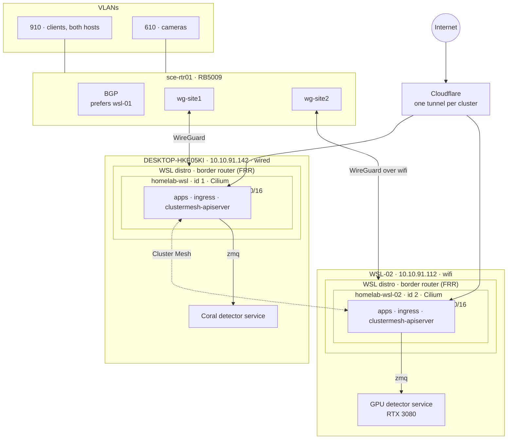
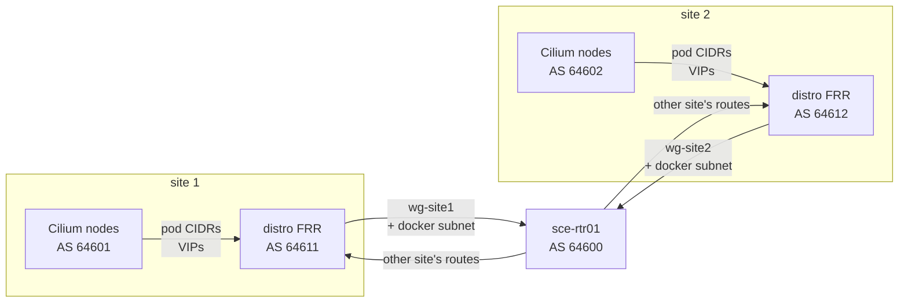
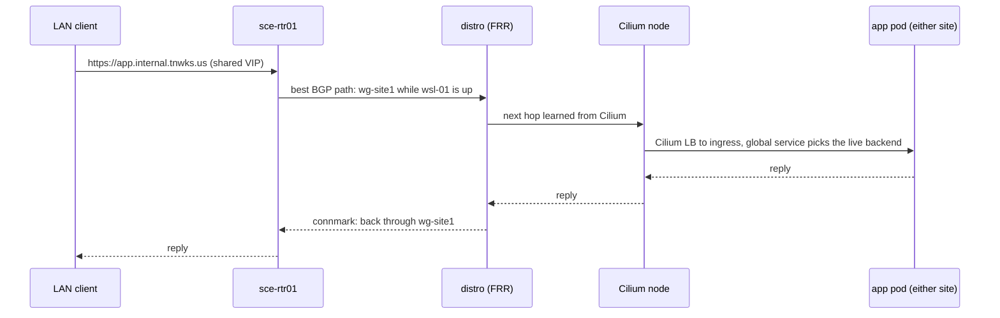
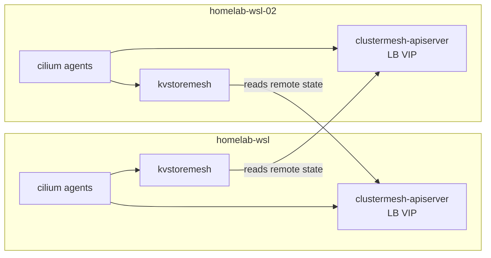
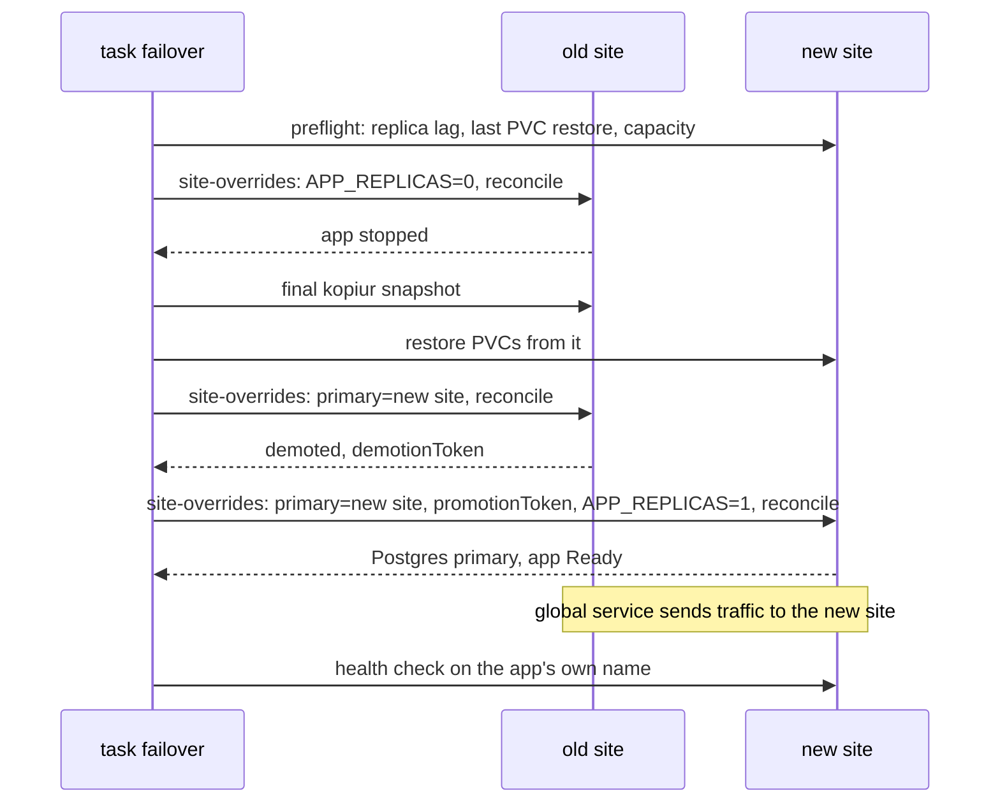
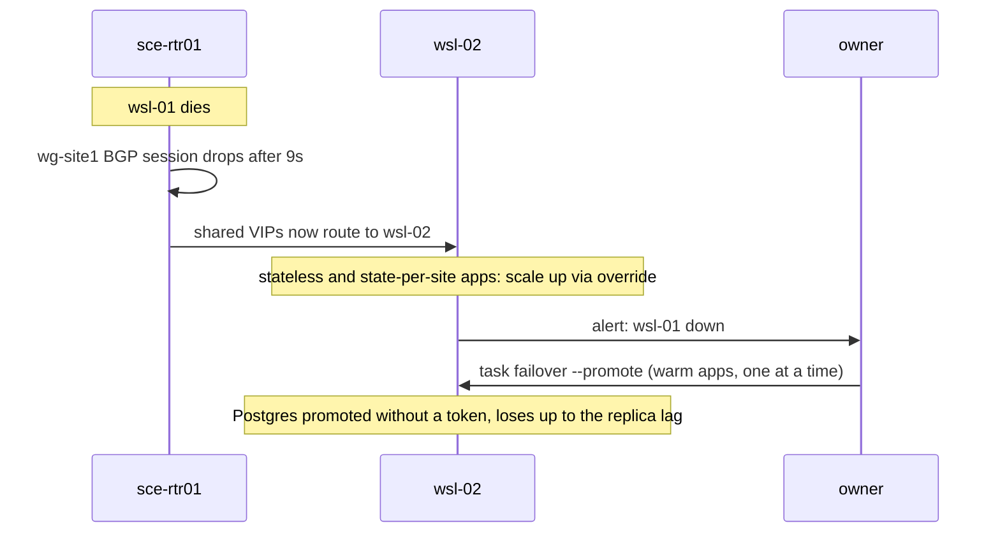

# Multi-site WSL: two clusters, one mesh

**Status: design (2026-11-05).** Nothing here is built. It describes the
target for the two WSL clusters and how an app moves between them, for
[Windows patching](../operations/windows-patching.md) and for real
failures. The [spike plan](#spike-plan) comes before any of it is built.
The routed network is going in in stages: the router side is applied, and
[Stage A](#stage-a-the-distros-as-border-routers) puts the tunnels and FRR
on the distros ([what B and C still need](#stages-b-and-c-still-open)).

| | wsl-01 | wsl-02 |
| --- | --- | --- |
| Windows host | `DESKTOP-HKE05KI`, `10.10.91.142`, wired | `WSL-02`, `10.10.91.112`, on wifi |
| Cluster | `homelab-wsl` | `homelab-wsl-02` |
| Role | primary for the home apps; standby for wsl-02's | primary for the non-critical apps; standby for wsl-01's key apps |
| Detector | Coral (Windows service, `zmq`) | RTX 3080 (Windows service, `zmq`) |

## Goals

- Both clusters run Cilium, joined by Cilium Cluster Mesh.
- Any movable app can run on either site. Moving it is a runtime switch
  that takes seconds to minutes: no pull request, no DNS change, and
  nothing on GitHub or CI has to be working.
- LAN and public clients use the same names and addresses whichever site
  is serving.
- Git still describes everything, including each app's default site.
  Flux is still the only thing that applies manifests.
- A planned move loses no data. An unplanned one loses at most the
  replication lag, and promoting a database stays a human decision.

## Superseded: placement map by pull request

The first design (second-cluster plan, 2026-11-04) moved an app by
changing a placement map in a PR, with DNS records generated from it by
Terraform in CI. It is replaced because it puts GitHub, Actions, a runner
on the surviving site, Flux's sync interval and a Terraform apply in the
path of every failover, which is exactly when some of them are likely to
be broken. A failover PR also has to be merged by CI, which needs a bot
token that can bypass review. The default site for each app still lives in
git (below); only the switch moved out of it.

## Topology



Each WSL distro becomes its site's border router. It holds a WireGuard
tunnel to the router, runs FRR, peers BGP with its own Cilium nodes on the
Docker bridge, and passes their routes on to the router. The router never
needs to know which Docker container is which node.

## Addressing

Cluster Mesh needs a unique cluster name and ID per cluster, and pod
ranges that don't overlap. wsl-02 gets its ranges before its bootstrap;
changing them later means rebuilding the cluster.

| | `homelab-wsl` (exists) | `homelab-wsl-02` (decided 2026-11-05) |
| --- | --- | --- |
| Cluster ID | 1 | 2 |
| Docker bridge (nodes) | `10.5.0.0/24` | `10.6.0.0/24` |
| Pods | `10.42.0.0/16` | `10.44.0.0/16` |
| Services | `10.43.0.0/16` | `10.45.0.0/16` |
| BGP ASN (Cilium nodes) | 64601 | 64602 |
| BGP ASN (distro FRR) | 64611 | 64612 |
| WireGuard to the router | `wg-site1` | `wg-site2` |

The router is ASN 64600. Shared service addresses (the ingress VIP, MQTT)
come from one new pool, `10.10.95.0/24`, which both clusters' Cilium LB
IPAM hand out with the same address per service. None of these ranges is
in use in `infrastructure/terraform/modules/mikrotik` or the Talos configs
today; the spike confirms against the live router.

## Network

### Why a routed network

Cluster Mesh needs every node to reach the other cluster's nodes and pods
without address translation. Today nothing outside a host can reach its
nodes: they sit behind Docker's NAT, then WSL's NAT, then Windows. The LAN
bridge (portproxy, socat, UDP relays) only forwards chosen ports.

### WireGuard: one interface per site

- Each distro dials a WireGuard tunnel to the router. The distro starts the
  connection, so WSL's NAT and its changing address don't matter
  (persistent keepalive keeps it open).
- **One WireGuard interface per site on the router, one peer each.**
  WireGuard picks the peer by the packet's destination address, and both
  sites announce the same shared VIP, so two peers on one interface would
  fight over it. With one peer per interface, BGP picks the interface and
  the peer follows. `wg01` stays the admin VPN.
- Each `wg-site` interface is its own zone in the router's zone firewall,
  allowed to reach what the clusters need (cameras, MQTT clients, the
  other site) and nothing else.
- MTU 1420 on the tunnels. Cilium's MTU is set explicitly to match,
  because it only sees the Docker bridge's 1500 and doesn't know about the
  tunnel. The spike measures the real path MTU over wsl-02's wifi.

### BGP



- Cilium's BGP control plane on every node peers with its distro's FRR at
  the Docker bridge gateway (`10.5.0.1`, `10.6.0.1`), which is directly
  connected, so BGP doesn't depend on the tunnel.
- Cilium announces each node's pod CIDR and the LoadBalancer addresses it
  serves. FRR adds the Docker subnet and passes everything to the router,
  with itself as next hop.
- **The router prefers wsl-01** for the shared VIPs (a routing filter on
  the `wg-site2` session sets a lower local preference). wsl-02's
  announcement takes over when wsl-01's session drops.
- Hold timer 9 seconds (keepalive 3), so a dead site is withdrawn in under
  10 seconds. Graceful restart on, so a Cilium agent restart doesn't flap
  the routes.
- All of the router side (interfaces, peers, zones, BGP connections,
  filters) is Terraform in `modules/mikrotik`, like the rest of the router.
  The distro side (WireGuard, FRR, the rules below) is Ansible, roles
  `wsl_*`.

### The distro as a router

- IP forwarding on. Static routes aren't needed: FRR learns its own
  cluster's routes from the nodes and the other site's from the router.
- **Docker 28 drops routed traffic into a bridge network** unless the
  network's gateway mode is `routed` or `nat-unprotected`. The Talos
  network needs one of them, plus a masquerade exemption so traffic from
  the nodes to the other site leaves with its real address. `routed` breaks
  talosctl (no host port publishing), so it's `nat-unprotected` with
  `enable_ip_masquerade=false` and a fixed bridge name, set when the network
  is created (Stage B below); talosctl reuses a network made beforehand.
- Cilium native routing, with `ipv4NativeRoutingCIDR` covering both pod
  ranges, so pod-to-pod traffic across sites isn't masqueraded. VXLAN would
  only need node routes, but it stacks a tunnel inside WireGuard; BGP is
  needed for the VIPs anyway.
- **Camera ingest stays off WireGuard.** Frigate pulls RTSP the way it does
  today: out through Docker, WSL and Windows' NAT. Only traffic that
  arrives through the tunnel goes back through it: the distro marks
  connections that came in on `wg-site` (connmark) and routes their replies
  back through it with a policy rule. Everything else keeps the default
  route.

### Packet paths



Pod to pod across sites: pod `10.42.x` to its node, the Docker bridge, the
distro, `wg-site1`, the router, `wg-site2`, wsl-02's distro, its node, pod
`10.44.x`. No NAT anywhere on the way.

### Router capacity

Measured on 2026-11-05 at about 00:25:

- RB5009UG+S+, RouterOS 7.25, 4 ARM64 cores. 9 to 11 percent total CPU,
  with the clock scaled down to 350 to 700 MHz at the time.
- Camera VLAN 610 to VLAN 910: about 54 Mbps live, and 55 Mbps averaged
  over 10.3 days of uptime (6.13 TB received on `bridge-lan-vlan610`).
- No FastTrack rule (65 filter rules), so today's camera traffic already
  takes the router's full path. The existing WireGuard interfaces are
  nearly idle.

Published RB5009 WireGuard results run to about 300 Mbps for one TCP flow,
400 to 800 Mbps per tunnel, and over 1 Gbps across several tunnels
([r/mikrotik](https://www.reddit.com/r/mikrotik/comments/13ckqkn/rb5009_wireguard_performance/),
[Improving the RB5009 WireGuard performance](https://blog.louis-vallat.dev/improving-the-rb5009-wireguard-performance/),
[MikroTik forum](https://forum.mikrotik.com/t/routeros-wireguard-performance-other-tunneling/183496)).
So even 100 Mbps of cameras through a tunnel would cost the router roughly
10 to 20 percent more CPU. With camera ingest kept off the tunnels, normal
tunnel traffic is single-digit Mbps: LAN clients on the VIPs, mesh control
traffic, Postgres replication, with spikes while someone watches live
camera views.

**The tighter link is wsl-02's wifi**: 270 Mbps reported, realistically
120 to 170 Mbps of TCP, shared in both directions. With Frigate failed over
to wsl-02, about 100 Mbps of camera streams (with the three planned
cameras) arrives over that wifi on top of replication and the tunnel.
**Decided 2026-11-05: wsl-02 stays on wifi for now, and Frigate may
underperform there while failed over.** Wiring it needs new copper and new
hardware first. Frigate keeps its normal profile on wsl-02; dropped frames
or recording gaps during a failover are accepted. When it's wired, move the
DHCP reservation to the 2.5GbE port's MAC.

### The router side in Terraform

Applied. The inputs are hand-written in
`infrastructure/terraform/environments/prod/mikrotik/site-tunnels.tf`; the
BGP resources are `modules/mikrotik/bgp.tf`. The router BGP spike
(2026-11-06) ran against exactly this config from throwaway namespaces on
both hosts: both tunnels and sessions came up, the shared VIP preferred site
1 and failed over in 1.3 s (FRR stopped) or about 8 s (site silent), and
connmark return routing was required.

| | `wg-site1` (homelab-wsl) | `wg-site2` (homelab-wsl-02) |
| --- | --- | --- |
| Router address / distro address | `10.10.33.1/30` / `10.10.33.2` | `10.10.34.1/30` / `10.10.34.2` |
| Router listen port | 51823 | 51824 |
| Accepted from (Windows host, VLAN 910) | `10.10.91.142` | `10.10.91.112` |
| Firewall zone | `wsl-site1` | `wsl-site2` |
| Distro FRR ASN | 64611 | 64612 |
| Local preference for shared VIPs | 100 | 50 |

- **WireGuard**: MTU 1420, no endpoint on the router side (the distro
  dials in). Each peer's allowed addresses are its tunnel address, its node
  subnet, its pod range and the VIP pool. The router's private keys are in
  the MikroTik SOPS file; each distro's is `wsl_site_wireguard_private_key`
  in `infrastructure/ansible/inventory/host_vars/<distro>/secrets.sops.yml`.
  The router's public keys are the module's `wireguard_public_keys` output
  (copied into each distro's host_vars, `wsl_site_routing_router_public_key`).
- **Firewall**: to the router, each tunnel's UDP port from its Windows host
  only, and tcp/179 from its distro's tunnel address only. Forward: VLAN 910
  and the admin VPN (`vpn`) to each site's nodes, pods and the VIP pool;
  site to site between nodes and pods (Cluster Mesh). Replies are the global
  established/related accept. Nothing is opened from a site to the LAN or the
  internet.
- **BGP**: instance `as64600`, router ID `10.10.91.1`, one eBGP connection
  per site to the distro's tunnel address, hold time 9 s, keepalive 3 s. In
  from each site: its node subnet (exactly `/24`), its pod range (`/16` to
  `/24`) and VIPs from `10.10.95.0/24` (only `/32`, so both sites announce
  the same prefix and local preference decides). Out to each site: the other
  site's node subnet and pod range, not the VIPs. Everything else is
  rejected (a RouterOS filter chain's default).
- **Not covered**: graceful restart can't be configured on the router
  (provider v1.99.1 has no argument; RouterOS 7 has no setting), so it's for
  Cilium and FRR in the distro. Site to LAN (MQTT clients, cameras over the
  tunnel) stays closed until something needs it. The router's strict
  reverse-path filter drops a VIP reply that comes back through the site
  that isn't the VIP's best path; with connmark return routing in the distro
  that shouldn't happen.

### Stage A: the distros as border routers

Role `wsl_site_routing` (`infrastructure/ansible/roles/wsl_site_routing/`,
playbook `wsl-distro.yml`, tag `site-routing`), on where a distro's
host_vars sets `wsl_site_routing_enabled`; both do. CI checks it on the
pull request and applies it on merge (`ansible-hosts.yaml`). Stage A
changes nothing a cluster uses today: no traffic arrives on the tunnels
until something announces a pod CIDR or a VIP. Each distro does learn the
other site's node subnet, routed into its tunnel, but nothing uses it yet,
and it can't carry traffic before Stage B (below).

| | site 1 (`DESKTOP-HKE05KI-ubuntu`) | site 2 (`WSL-02-ubuntu`) |
| --- | --- | --- |
| Tunnel | `wg-site1`, `10.10.33.2/30`, to `10.10.91.1:51823` | `wg-site2`, `10.10.34.2/30`, to `10.10.91.1:51824` |
| FRR ASN / router ID | 64611 / `10.10.33.2` | 64612 / `10.10.34.2` |
| Cilium peer group (Stage C) | `10.5.0.0/24`, AS 64601 | `10.6.0.0/24`, AS 64602 |
| Docker network (bridge looked up by name) | `homelab-wsl` | `homelab-wsl-02` |

- **WireGuard: `wg-quick@wg-site<N>`** (`/etc/wireguard/wg-site<N>.conf`),
  in the distro's root namespace, so its UDP leaves `eth0` and Windows NAT
  gives it the host's VLAN 910 address, which the router requires. MTU 1420,
  `AllowedIPs = 0.0.0.0/0` (LAN clients' sources are arbitrary; the router
  restricts), keepalive 25, and `Table = off`: routes come from FRR, replies
  from the connmark table. The private key is its own 0600 file, set by the
  first `PostUp`, so the config has nothing secret and its diff can be shown.
  The second `PostUp` puts back the connmark table's route, which goes away
  with the interface.
- **FRR 10.5 in a container: `tnwks-frr.service`**, a systemd unit around
  `docker run --rm --network host` with the image pinned by digest
  (`quay.io/frrouting/frr:10.5.0@sha256:…`) and `/etc/tnwks-frr` mounted
  read-only. Why a container: Ubuntu noble ships FRR 8.4, and FRR's apt
  repository needs an `apt update`, which fails on `DESKTOP-HKE05KI`. Why
  systemd around it rather than a restart policy: ordering after dockerd,
  `systemctl status`/`journalctl -u tnwks-frr` like the other `tnwks-*`
  units, and a restart when dockerd restarts. The image's entrypoint is
  tini, so the daemons are reaped (the spike's zombie `bgpd` came from
  replacing the entrypoint with `sleep`); no `--init`. Every config is
  checked with the pinned image's `vtysh --dryrun` before it's written; a
  change restarts the container, which sends NOTIFICATION, so the router
  moves any VIP at once.
  - To the router: timers 3/9, connect 5, graceful restart left at FRR's
    default (helper only). Out (`TO-RTR`): exactly what the router accepts,
    the node subnet (a `network` statement on the connected bridge route,
    so it's announced now, and withdrawn while the Docker network is gone),
    pod CIDRs `/16` to `/24` in the site's range, and `/32`s from the VIP
    pool. In (`FROM-RTR`): the other site's node subnet and pod CIDRs,
    installed in the main table.
  - Ready for Stage C: `bgp listen range <node subnet> peer-group CILIUM`
    (remote AS 64601 or 64602), timers 3/9, graceful-restart helper, in
    filter pod CIDRs and VIP `/32`s, `maximum-prefix 512`, `maximum-paths 8`
    (ECMP across nodes with the same VIP), and an out route-map that denies
    everything.
- **Forwarding and return routing: `tnwks-site-routing.service`**, a oneshot
  unit around `/usr/local/bin/tnwks-site-routing` (settings in
  `/etc/default/tnwks-site-routing`). It builds its own chains with
  `iptables-restore --noflush`, so a re-run (`systemctl reload
  tnwks-site-routing`) replaces them in place, and jumps to them once from
  the built-in chains and `DOCKER-USER`. It runs at boot after dockerd and on
  every apply that changes it.
  - `ip_forward=1`, `rp_filter=2` (also `/etc/sysctl.d/90-tnwks-site-routing.conf`).
  - Connmark: mangle `PREROUTING -i wg-site<N>` NEW sets bit `0x10000` on
    the connection; `PREROUTING -i <bridge>` copies it back onto the reply
    packets; `ip rule fwmark 0x10000/0x10000 lookup 200` (priority 1000),
    and table 200 holds `default dev wg-site<N>`. Never in `OUTPUT`: the
    distro's own frag-needed ICMP would follow the mark into the tunnel and
    break path MTU discovery.
  - MSS clamping on `wg-site<N>` both ways: set to 1380 on SYNs coming in,
    clamp to PMTU on SYNs going out.
  - Filter (`TNWKS-SR-FWD`, from `DOCKER-USER`): from the tunnel only to
    this site's node subnet, pod range and the VIP pool; anything else is
    dropped. Allowed traffic returns to Docker's own rules, it isn't
    accepted here.
  - `TNWKS-SR-MISROUTED`, a counted drop: a reply to a tunnel connection
    about to leave by `eth0` (the tunnel is down, so the table's route is
    gone), and anything from the VIP pool leaving by `eth0`. Without it those
    leave quietly past Docker's masquerade and Windows drops them.
    `iptables -vL TNWKS-SR-MISROUTED` shows the count; nothing alerts on it
    yet.
  - The bridge is looked up from the Docker network's name on every run
    (its `com.docker.network.bridge.name`, else `br-<id>`), so after Stage B
    renames it a `systemctl reload tnwks-site-routing` picks it up
    (`recreate-network.sh` does it; an Ansible apply doesn't, since nothing
    in the role changed). Without the network, the bridge rules are left
    out and the rest applies.

### Stages B and C

- **Stage B, the Docker networks.** Until then nothing on the tunnel reaches
  a node: Docker 28's nat-mode bridge drops routed traffic into it (raw
  `PREROUTING` drops per container address), and Docker masquerades the
  nodes' traffic to the other site to the distro's tunnel address, which
  the router's site-to-site policy doesn't allow. Stage B recreates each
  network as `nat-unprotected` with `enable_ip_masquerade=false` and a fixed
  bridge name (`br-site1`, `br-site2`), and the distro masquerades the node
  subnet out of `eth0` only (`wsl_site_routing_masquerade`, on in both
  distros' host_vars; next to Docker's nat-mode MASQUERADE it changes
  nothing, both rewrite to `eth0`'s address).
  - Where it's set: `talos_clusters.<site>.docker_network`
    (`inventory/group_vars/all/talos.yml`). `01-talos-bootstrap.yml` creates
    the network with it when it's missing (labels `talos.owned` and
    `talos.cluster.name`, explicit gateway), so a rebuild comes up right:
    talosctl 1.13 and 1.14 both reuse it. An existing network is only
    compared, and a difference is a warning
    (`-e talos_docker_network_strict=true` makes it fail).
  - Options are immutable, so a running cluster moves with
    `talos/wsl/recreate-network.sh` (`task talos:network:wsl`, or on
    WSL-02's distro the script itself). The containers aren't recreated:
    `docker stop -t 120`, disconnect, rm, create with the same subnet,
    gateway and labels plus the new options, `connect --ip <same address>`,
    start, then `systemctl reload tnwks-site-routing` (the bridge name
    changed) and a wait for the Talos and Kubernetes APIs. Volumes, binds,
    restart policy and the published `127.0.0.1` ports (so talosconfig and
    kubeconfig) stay as they are. Before anything goes down it checks the
    options on a scratch network and refuses when a bind source is missing
    (site 1's worker-2: `/dev/bus/usb`, the Z-Stick, E:). Docker would
    otherwise start the node with an empty directory in its place.
  - **About 90 s down per site** (rehearsed 2026-11-06 on a throwaway
    cluster on WSL-02, 6 runs): Services go at once (Talos's graceful
    shutdown takes about 30 s), the Kubernetes API is out about 45 s, the
    Talos API 2-3 s, and the swap itself is under a second. After that,
    each app needs its own start time. Deployment pods come back as new
    pods. Order of the nodes doesn't matter.
  - Order: the masquerade on first (merged and applied before the window;
    without it the nodes have no internet egress after the swap and image
    pulls fail), then site 2, then site 1. Per site:
    `recreate-network.sh --dry-run <cluster> <bridge>`, then the run.
    Afterwards, check the BGP sessions (`docker exec tnwks-frr vtysh -c
    'show bgp summary'`). The router loses the node subnet while the bridge
    is gone. On site 2, the Cilium sessions drop with the nodes and peer
    again once the agents are back, after about a minute; graceful restart
    is 30 s, so their routes are withdrawn first.
  - Rollback: `recreate-network.sh --rollback <cluster>` recreates it with
    only the MTU option, as talosctl made it (same 90 s). The masquerade can
    stay on.
  - With `nat-unprotected`, Docker accepts every port from any routed
    interface: `TNWKS-SR-FWD` (tunnel to node subnet, pod range and VIP
    pool only) and the router's policy are the only filters.
- **Stage C, Cilium's BGP control plane** toward FRR at the bridge gateway
  (`10.5.0.1`, `10.6.0.1`). `bgpControlPlane.enabled` is
  `CILIUM_BGP_ENABLED` in the shared HelmRelease; the peering is
  `kubernetes/apps/kube-system/cilium/bgp` (Flux Kustomization
  `cilium-bgp`, listed per cluster):
  - `CiliumBGPClusterConfig` on every node: local AS `CILIUM_BGP_LOCAL_ASN`
    (64601/64602), peer `CILIUM_BGP_PEER_ADDR` / `CILIUM_BGP_PEER_ASN`
    (64611/64612).
  - `CiliumBGPPeerConfig`: timers 9/3/5 like the router's, graceful restart
    30 s (FRR is a helper, so an agent restart doesn't withdraw a VIP; a node
    that really died keeps its routes in FRR that long).
  - `CiliumBGPAdvertisement`: each node's `PodCIDR`, and the
    `LoadBalancerIP` of Services labelled `tnwks.us/shared-vip: "true"`.
  - `CiliumLoadBalancerIPPool` `shared-vip` (`SHARED_VIP_POOL`,
    `10.10.95.0/24`), for those Services only, and only by asking for an
    address: the same one in both clusters.

  homelab-wsl-02 runs it first. homelab-wsl follows after its move to
  Cilium. The router learns the pod CIDRs and VIPs from then on, but the
  tunnel only carries client traffic after Stage B. No Service has a shared
  VIP yet. Non-TCP traffic over the tunnel relies on PMTUD (MSS clamping
  only covers TCP). Cilium's pod MTU stays 1500.
- **Monitoring.** The tunnel's handshake, the BGP sessions and the misrouted
  counter have no alert yet.

## Cluster Mesh



- Requirements: unique `cluster.name` and `cluster.id` (table above),
  non-overlapping pod ranges, Cilium versions within one minor of each
  other, and a shared Cilium CA (the documented setup) so each side trusts
  the other's certificates.
- Each cluster runs a `clustermesh-apiserver` behind a LoadBalancer address
  from its own pool (not shared: each side has to reach the other's).
  KVStoreMesh caches the remote state locally, so agents never talk across
  the tunnel themselves.
- The mesh's TLS material is SOPS-encrypted in git, like other secrets.

### Global services

```yaml
metadata:
  annotations:
    service.cilium.io/global: "true"
    service.cilium.io/affinity: local
```

A Service with the same name and namespace in both clusters, marked
global, gets the endpoints of both. With affinity `local`, traffic stays on
the local site while it has ready endpoints and goes to the other site when
it has none. So when an app scales to 0 on wsl-01 and up on wsl-02,
everything that addresses it (ingress, Home Assistant reaching Frigate or
MQTT) follows it without a change.

Network policy: a selector without a cluster label matches pods in every
cluster unless `policy-default-local-cluster` is set (check the default for
the installed Cilium version). Policies for cross-site traffic name the
cluster with `io.cilium.k8s.policy.cluster`.

## Apps

| Tier | Apps | On a move |
| --- | --- | --- |
| Warm | Mealie, Home Assistant, Firefly, storefront API | switchover: database primary and PVC data move |
| Moves, state per site | Frigate, mosquitto | only config moves; each site keeps its own state |
| Stateless | sites, playwright-mcp | scale up there, down here |
| Cold | media stack, Immich | stay down until their home site is back |
| Pinned | zwave-js-ui (Z-Stick) | down while wsl-01 is down. Home Assistant runs without Z-Wave on wsl-02; accepted |
| Not placed | monitoring, the OpenClaw gateway | each site runs its own monitoring and watches the other |

Vaultwarden isn't in use and isn't planned for.

**Frigate.** On wsl-02 it detects on the RTX 3080 through a Windows-side
detector service: the same `zmq` pattern as the Coral on wsl-01
([coral-detector.md](coral-detector.md)), with an ONNX model on the GPU.
Role `windows_coral_detector` grows a backend option (Coral or ONNX on
GPU). Passing the GPU into the cluster isn't an option, because Talos
nodes running as Docker containers can't load the NVIDIA support a pod
would need. The detector endpoint and model settings come from per-site
cluster settings. Frigate keeps its own database and recordings on each
site: copying the database across and back would lose track of the
recordings that stay on wsl-01. Old footage stays on wsl-01, and footage
from a failover stays on wsl-02 until its retention removes it.

**mosquitto.** Moves with nothing copied: clients republish their state
and Home Assistant discovery when they reconnect. Its address is a shared
VIP, so LAN clients don't change. Anything that still points at
`10.10.91.142` by IP moves to a hostname first.

## Switching an app

Every movable app is deployed on both clusters from the shared
`kubernetes/apps`. Which site serves it is one variable per app.

- **Git holds the default.** Manifests use substitutions with defaults,
  for example `replicas: ${MEALIE_REPLICAS:=1}`, and each cluster's
  `cluster-settings` sets its side: 1 on the home site, 0 on the standby.
- **A runtime ConfigMap holds the override.** The `cluster-apps` patch in
  `kubernetes/clusters/<cluster>/apps.yaml` adds a third source to every
  app's `postBuild.substituteFrom`: ConfigMap `site-overrides`, `optional:
  true`. Later sources win, so a value there overrides `cluster-settings`.
  Nothing in git creates it; `task failover` does.
- Flux still applies everything. The override only changes one of its
  inputs, so this stays within the repo's rule that Flux is the only thing
  that mutates the cluster.
- **CNPG** uses the same mechanism. Each warm app's Postgres runs in CNPG's
  distributed topology: one cluster per site, `spec.replica.primary` names
  the site that's primary, and the standby replays the primary's WAL from
  S3 (`kubernetes/components/cnpg-standby`; streaming over the mesh can come
  later). The override sets `primary` and the promotion token on both sides.
- An alert fires when a `site-overrides` ConfigMap has existed for more
  than 24 hours, so a failover can't quietly become the new normal.
- Making a move permanent is an ordinary PR to `cluster-settings`, then
  deleting the override.

### Planned switchover



Failback is the same run in the other direction. Clearing both overrides
returns an app to its git default.

The commands `task failover` runs (`kubectl apply` of the ConfigMap, `flux
reconcile`) need only the two clusters' API servers. From the workstation
or either site's runner, nothing on GitHub has to be up.

### Running one: `task failover`

`bin/site-failover` runs the sequence above for one app. The apps it knows,
and their variables, deployments, Postgres cluster and PVCs, are in
`bin/site-failover-apps.json`.

```bash
# Run from homelab-wsl's distro. homelab-wsl-02's API is reached over SSH.
export FAILOVER_SSH_HOMELAB_WSL_02="<user>@10.10.91.112 -p 2222"
task failover:status APP=mealie
task failover APP=mealie TO=homelab-wsl-02          # asks for the app name
task failover APP=mealie TO=homelab-wsl             # failback
task failover:clear APP=mealie                      # only once git matches
```

- **Overrides.** It writes only the app's keys (`<P>_REPLICAS`,
  `<P>_PG_PRIMARY`, `<P>_PG_PROMOTION_TOKEN`, `<P>_BACKUP_SUSPEND`) to
  `flux-system/site-overrides`, as server-side apply field manager
  `site-failover-<app>`. Two apps' overrides can't overwrite each other.
  `clear` removes an app's keys, and deletes the ConfigMap once it's empty.
- **PVCs.** It takes a one-off kopiur `Snapshot` on the old site and a
  `Restore` on the new one, from the old site's repository (the read-only
  peer `ClusterRepository`, named after the site), as an exact mirror. A
  `transfer_only` PVC's snapshot is deleted afterwards: it isn't backed up
  (the transcriber's audio).
- **Postgres.** The old site is demoted first. The new site is promoted
  with the demotion token, so it replays to the old primary's last LSN: RPO 0.
  The old site then follows the new one, with no rebuild.
- **What it doesn't move: public traffic.** Internal names are router DNS
  records (`infrastructure/terraform/environments/prod/mikrotik/dns-sites.tf`).
  Public names go through homelab-wsl's cloudflared and public ingress, and
  homelab-wsl-02 has neither yet. A public app (Mealie) runs on wsl-02 during
  a drill but isn't reachable from outside until there's a mesh global
  service or a tunnel per site.
- **Making a move permanent:** a PR to both `cluster-settings` with the
  same values (no token), then `task failover:clear`. Clearing first would
  put the app back on git's defaults.
- **Weekly standby restore.** `kopiur-system/standby-restore` (a CronJob on
  both sites, Sundays 05:15) restores the other site's newest snapshot of
  each warm app's PVC into this site's copy, wherever the app is off here.
  It skips an app with `site-overrides` here (a switchover under way). It
  keeps the standby current and is the standing restore drill: a failure is
  `KubeJobFailed`, and no success for 8 days is `StandbyRestoreDrillStale`.
- **Unplanned: `--promote`.** For when the old site is dead. First set
  `site_leases.<app>` to the dead site (a PR to `dns-sites.tf`); the tool
  refuses until the router says so. Then run `task failover APP=<app>
  TO=<site> -- --promote`. It never contacts the old site. It restores the
  PVCs from the old site's newest kopiur snapshot (S3) and promotes without a
  token, which loses whatever wasn't archived yet. The fencing section below
  covers the return.

### Unplanned failure



Traffic moves on its own; it can't split anything, because only one site
runs a given app. Promoting a database without the old primary's token is
the one decision that can cause split brain if wsl-01 is in fact alive, so
it stays manual. When wsl-01 returns, its old primaries must be rebuilt as
replicas from wsl-02 before anything fails back.

### Fencing: one writer per app (site leases)

The split-brain case: wsl-02 was promoted while wsl-01 was dead, and wsl-01
comes back. Its etcd still says it's the primary (`<P>_PG_PRIMARY` from git,
`<P>_REPLICAS=1`), so its Postgres starts as a primary on the old timeline,
and the app starts writing to it before anyone can intervene. Both sites
would then accept writes.

A planned switchover can't split: the old primary demotes itself before the
new one is promoted with its token. Only an unplanned promote can, and the
**site lease** guards against exactly that. Each warm app has one: the site
fenced from writing it, or `none`.

- **Where it lives: the router**, as a static DNS TXT record
  `<app>.lease.tnwks.local` → `none`, `homelab-wsl` or `homelab-wsl-02`
  (Terraform, `site_leases` in
  `infrastructure/terraform/environments/prod/mikrotik/dns-sites.tf`).
  - Why not S3: both sites share a house, so they lose power together. After
    an outage the router and LAN are back within a minute, while the internet
    may not be. A lease that needs S3 would keep Home Assistant off until the
    ISP returns.
  - Reading it needs no credentials: any pod does a DNS TXT lookup.
  - `tnwks.local` has no match-subdomain entry, so the record can't be
    shadowed (RouterOS checks those first).
- **Who changes it: a PR, before the promote.** Set the dead site in
  `site_leases`, merge, and let the MikroTik workflow apply it.
  `bin/site-failover --promote` checks the lease and refuses to promote
  until it fences the old site, so the fence is always in place first. If
  GitHub is down, edit the TXT record on the router by hand, then make the
  same change in git (or the next apply reverts it). Planned switchovers
  never touch the lease.
- **App gate.** Each warm app's pod has an initContainer that waits while
  the lease names its own site (`${CLUSTER_NAME}`), and while the lease can't
  be read (router down, or no record yet), so it fails closed. A fenced site
  that comes back starts its apps, and they wait there instead of writing.
  `<P>_LEASE_GATE: "off"` (`site-overrides`) is the escape hatch.
- **Database fence.** A CronJob on each site checks every minute: if the
  lease names this site and its `<app>-pg` believes it's the primary, it
  sets `cnpg.io/fencedInstances: '["*"]'` on that Cluster, and the Job fails,
  so KubeJobFailed fires. That stops writers that don't go through the app,
  such as finance-sync's CronJobs. Afterwards: rebuild the fenced site's
  Cluster as a replica of the new primary (delete the Cluster and its PVC,
  bump `CNPG_SERVER_NAME`), then set the lease back to `none`.
- **What it doesn't cover.** A stateless app has nothing to split. A site
  that's alive but can't reach the router has no LAN either, so nobody can
  write to it.

## Getting wsl-01 onto Cilium

wsl-02 starts on Cilium with all of the above from its first bootstrap.
wsl-01 runs Flannel, and there's no mesh until it moves:

1. Fail the warm apps, Frigate and mosquitto over to wsl-02. Until the
   mesh exists that's a switchover with DNS changed by hand (or the old
   LAN bridge pointed at wsl-02).
2. Migrate wsl-01 node by node with Cilium's documented Flannel migration
   (Cilium alongside Flannel on a separate overlay, then one node at a
   time). Rebuilding the cluster is the fallback. Its `local-path`
   volumes are tied to the node containers, which is why migrating in
   place comes first.
3. Join the mesh, move the apps back.

## Risks

- The routed network carries all LAN to cluster traffic through the router
  and a tunnel, where today it's a port forward on the host.
- wsl-02's wifi carries the mesh, replication and, during a failover, the
  cameras.
- More moving parts per site: WireGuard, FRR, BGP, the mesh API server.
  Each needs an alert.
- Both sites still share the house's power, router and internet.

## Spike plan

A throwaway pair of clusters on wsl-01, built like the 2026-11-04 Cilium
test (state in `/tmp`, `homelab-wsl` untouched), plus a WireGuard peer and
BGP session on the router added by a Terraform PR the owner approves:

1. Two Talos-in-Docker clusters on separate Docker networks with routed
   gateway mode under Docker 28; nodes reach each other's nodes and pods.
2. FRR in the distro peering with the Cilium nodes and with the router over
   WireGuard; the router learns pod CIDRs and a VIP.
3. Cluster Mesh up; a global service with affinity `local` moves to the
   other cluster when its pods scale to 0, and back.
4. The shared VIP: router prefers cluster 1, fails over in under 10
   seconds when its session drops.
5. Path MTU through the tunnel; no stalls on large transfers.
6. A CNPG replica cluster streaming across the mesh; planned switchover
   with the demotion and promotion tokens through `site-overrides`.
7. Router CPU with 100 Mbps pushed through the tunnel.
8. Connmark return routing: a LAN client on the VIP and a pod pulling an
   RTSP stream from the camera VLAN at the same time.

## Open questions

- Cilium's BGP control plane in Talos-in-Docker nodes: any capability it
  needs beyond the 2026-11-04 overrides?
- The same address on both clusters' LB IPAM pools for shared services:
  confirm Cilium allows it with no L2 announcement on either side.
- RouterOS 7.25 BGP: per-session local preference through routing
  filters, and hold timers as low as 9 seconds.
